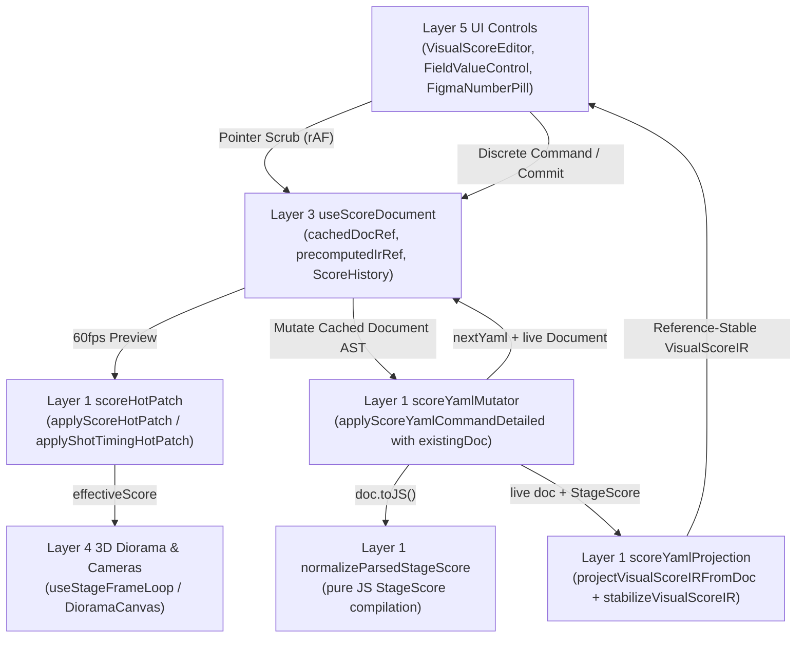

# StageFlow Visual YAML Editor — Technical Architecture & Authoring Guide (SSOT)

Authoritative technical specification, directorial usage manual, and troubleshooting reference for StageFlow's **Plain-Text-as-Truth Dual-Mode Choreography Score Studio (`[ Visual | YAML ]`)**.

---

## 1. Core Design Philosophy: Plain-Text-as-Truth

StageFlow's Visual Score Editor does **not** maintain a parallel mutable JSON state tree. Canonical truth always remains the user's raw YAML text string (`rawYaml`):

1. **Comment & Format Preservation**: Visual interactions dispatch surgical AST commands (`ScoreYamlCommand`) through `yaml.parseDocument()` so `#` section banners, inline comments, key ordering, numeric-flow tuples (`[x, y, z]`), and omitted defaults remain untouched.
2. **Authored-Only Projection**: Only keys actually written in YAML render as active rows. Unauthored optional keys stay hidden behind schema-driven `+ Key` / `+ Entry` popovers.
3. **Graceful Custom Key Survival**: Any unregistered custom YAML key (e.g. directorial annotations or experimental metadata) projects as a `raw`-badged editable field (`kind: 'raw-yaml'`) instead of being dropped or overwritten.
4. **Unified History Stack**: CodeMirror 6 text edits (`mode: 'coalesce'`, 800ms / 32-char grouping) and Visual Editor edits/scrub commits (`mode: 'checkpoint'`) write to the exact same monotonic `ScoreHistoryState` (`Cmd/Ctrl+Z`, `Cmd/Ctrl+Shift+Z`, `Ctrl+Y`, plus redoable session-baseline Reset). CodeMirror's built-in `history()` extension is intentionally omitted in `useYamlEditor.ts` so Visual and YAML modes never maintain competing undo stacks.

---

## 2. 5-Layer Architecture & Data Flow

### Module Inventory

| Layer | Module | Single Responsibility |
| :--- | :--- | :--- |
| **Layer 1** | [`src/core/schema/scoreSchemaTypes.ts`](../src/core/schema/scoreSchemaTypes.ts) | Runtime `as const` enum presets, `SchemaSectionName`, `FieldKind`, `FieldGroup`, `FieldDescriptor` types (`description`, `multiline`). |
| **Layer 1** | [`src/core/schema/scoreSchemaRegistry.ts`](../src/core/schema/scoreSchemaRegistry.ts) | `FieldDescriptor` catalogs for `root`, `optics`, `stage`, `entity`, `blockingCue`, `blockingEntity`. |
| **Layer 1** | [`src/core/schema/scoreCameraSchemaRegistry.ts`](../src/core/schema/scoreCameraSchemaRegistry.ts) | `FieldDescriptor` catalogs for `stageBaseCamera`, `shot`, `cameraCue`, `observerCameraCue`, `rig`, `waypoint`, `observerShot`. |
| **Layer 1** | [`src/core/scoreSchema.ts`](../src/core/scoreSchema.ts) | SSOT facade exporting `SCORE_SCHEMA_REGISTRY`, `SECTION_STRUCTURAL_KEYS`, alias resolver `lookupFieldDescriptor`, and `+ Key` filtering. |
| **Layer 1** | [`src/core/scoreYamlProjectionHelpers.ts`](../src/core/scoreYamlProjectionHelpers.ts) | `VisualScoreIR` node types, `readPairKey()`, `projectMetadataBlock()`, `projectMapFields()`, `stabilizeVisualScoreIR()`. |
| **Layer 1** | [`src/core/scoreYamlProjection.ts`](../src/core/scoreYamlProjection.ts) | Single-parse `projectVisualScoreIRWithDoc()` / `projectVisualScoreIRFromDoc()` projection. |
| **Layer 1** | [`src/core/scoreYamlTimingMutator.ts`](../src/core/scoreYamlTimingMutator.ts) | `setMapNode()` (`Scalar` key enforcement), `applyInsertShotSplit()`, and `applyAdjustShotTiming()` (`free`, `roll`, `ripple`). |
| **Layer 1** | [`src/core/scoreYamlMutator.ts`](../src/core/scoreYamlMutator.ts) | Comment-preserving `applyScoreYamlCommandDetailed()` AST mutator (CRUD, reorders, null-map self-healing, `|` block literals). |
| **Layer 1** | [`src/core/scoreHotPatch.ts`](../src/core/scoreHotPatch.ts) | Zero-parse `applyScoreHotPatch()` and `applyShotTimingHotPatch()` for 60fps pointer scrubbing. |
| **Layer 1** | [`src/core/scoreHistory.ts`](../src/core/scoreHistory.ts) | Pure undo/redo/baseline-reset stack with coalescing & monotonic `revision`. |
| **Layer 3** | [`src/hooks/useScoreDocument.ts`](../src/hooks/useScoreDocument.ts) | Owns `scoreHistory`, cached live `YAML.Document` AST (`cachedDocRef`), `VisualScoreIR` cache, 60fps `previewScore`, global shortcuts. |
| **Layer 5** | [`src/ui/editor/visual/VisualScoreEditor.tsx`](../src/ui/editor/visual/VisualScoreEditor.tsx) | YAML-mirrored scrollable workspace, section fold toggle, double-rAF `Active` shot scroll/expand, stabilized `entities` & `callbacks`. |
| **Layer 5** | [`src/ui/editor/visual/SchemaFieldRow.tsx`](../src/ui/editor/visual/SchemaFieldRow.tsx) | Property row shell: drag handle, key name, `(?)` `FieldInfoPopover`, `raw` badge, `FieldValueControl`, `ConfirmDeleteButton` (stacked full-width when multiline). |
| **Layer 5** | [`src/ui/editor/visual/FieldValueControl.tsx`](../src/ui/editor/visual/FieldValueControl.tsx) | Control dispatcher: `FigmaNumberPill`, `Vec3ScrubRow`, `TargetAnchorControl`, `InspectorSelect`, optimistic `boolean` switch, color picker, `AutoSizeTextarea`, text input. |
| **Layer 5** | [`src/ui/editor/visual/FigmaNumberPill.tsx`](../src/ui/editor/visual/FigmaNumberPill.tsx) | Vertical (`ns-resize`) scrubbable number pill (`ChevronsUpDown` indicator, rAF scrub, `Shift`/`Alt`, `Esc` cancel, click-to-type). |
| **Layer 5** | [`src/ui/editor/visual/ConfirmDeleteButton.tsx`](../src/ui/editor/visual/ConfirmDeleteButton.tsx) | 2-click inline confirmation delete trigger (`X` / `Trash2` → rose `Del?` pill with 2.6s auto-disarm). |
| **Layer 5** | [`src/ui/editor/visual/AutoSizeTextarea.tsx`](../src/ui/editor/visual/AutoSizeTextarea.tsx) | Auto-growing multi-line `<textarea>` (`data-native-undo="true"`, `Ctrl/Cmd+Enter` commit, `Esc` cancel). |
| **Layer 5** | [`src/ui/editor/visual/FieldInfoPopover.tsx`](../src/ui/editor/visual/FieldInfoPopover.tsx) | Lazy Radix `?` popover displaying label, detailed explanation, type/unit, min/max range, default, valid enum options, and aliases. |
| **Layer 5** | [`src/ui/editor/visual/InspectorSelect.tsx`](../src/ui/editor/visual/InspectorSelect.tsx) | Theme-native `@radix-ui/react-select` portal dropdown (with empty-string sentinel guard). |
| **Layer 5** | [`src/ui/editor/visual/AddPropertyPopover.tsx`](../src/ui/editor/visual/AddPropertyPopover.tsx) | Lazy Radix `+ Key` categorized property menu fed by `getAvailableAddFields()`. |
| **Layer 5** | [`src/ui/editor/visual/sections/*`](../src/ui/editor/visual/sections/) | Section views: `SceneAndStageSection`, `SceneMetadataBlock`, `SceneMetadataControls`, `EntitiesSection`, `BlockingSection`, `ShotsSection`, `ShotCard`, `ShotTimingBar`, `CameraBlockCard`, `ObserverShotsSection`. |

---

## 3. Schema Registry Contract (`scoreSchema.ts`)

Every YAML property known to the Visual Editor is declared once in `SCORE_SCHEMA_REGISTRY` across 13 parser-aligned section scopes:

- `root` · `optics` · `stage` · `stageBaseCamera` · `entity` · `blockingCue` · `blockingEntity` · `shot` · `cameraCue` · `observerCameraCue` · `rig` · `waypoint` · `observerShot`

`SECTION_STRUCTURAL_KEYS` reserves child containers (`metadata`, `optics`, `stage`, `entities`, `blocking`, `shots`, `score`, `observer_shots`, `stage_camera`, `observer_camera`, `camera`, `rig`, `waypoints`, `points`) so `projectMapFields()` renders them as specialized structural cards instead of scalar rows (`stageBaseCamera` holds strictly the 7 fields read by `parseBaseSphericalPose`; `observerCameraCue`/`observerShot` exclude Stage Cam-only optics/frustum keys; `shot` flat keys scope strictly to `applyFlatShotCameraOverrides`).

### Adding a New Schema Field
1. Register the `FieldDescriptor` in `scoreSchemaRegistry.ts` or `scoreCameraSchemaRegistry.ts` (`key`, optional `aliases`, `label`, `kind`, `group`, concise `hint`, detailed `description`, optional `multiline: true`, and `defaultOnAdd`).
2. Add any new enum constants as `as const` arrays in `scoreSchemaTypes.ts` and import their union in `types.ts` (zero duplicate string unions).
3. Verify parser/evaluator support (flat AND nested syntax per `AGENTS.md §2.6`).
4. Run `npm test` — `tests/unit/scoreSchemaContract.test.ts` automatically audits all 19 bundled scores against `SCORE_SCHEMA_REGISTRY`.

---

## 4. AST Mutation & Live-AST Invariants

### Critical Invariant: `readPairKey` + `setMapNode`
> [!CAUTION]
> In `yaml` v2 (`YAMLMap`), calling `map.set('someKey', node)` inserts a raw JS `string` as `pair.key` (`isScalar(pair.key) === false`). Because `useScoreDocument` projects immediately from the live returned `Document` AST without re-parsing text, **every mutator write MUST wrap keys with `setMapNode(doc, map, key, valueNode)`** (`new Pair(doc.createNode(key), valueNode)`), and **every projector/mutator loop MUST read keys with `readPairKey(pair.key)`** (`isScalar(k) ? String(k.value) : typeof k === 'string' || typeof k === 'number' ? String(k) : null`).

### Supported `ScoreYamlCommand` Operations

| Command `type` | Payload | AST & Placement Behavior |
| :--- | :--- | :--- |
| `set-field` | `path`, `value`, `format?` | Mutates existing `Scalar` / `YAMLSeq` in place (preserving inline `#` comments); sets `Scalar.BLOCK_LITERAL` (`|`) if string has `\n`, or restores `QUOTE_DOUBLE` if cleared to single-line; creates pair via `setMapNode` if absent. |
| `add-field` | `parentPath`, `key`, `value`, `format?` | Inserts new scalar pairs **before** `STRUCTURAL_BLOCK_KEYS` (`stage:`, `entities:`, `shots:`, `stage_camera:`, etc.) rather than appending at EOF; calls `ensureMapAtPath()` if parent block does not exist yet. |
| `remove-field` | `path` | Deletes scalar field, sequence item by index, or entire sub-block (`['optics']`, `['metadata']`, `['shots', i, 'observer_camera']`) via `doc.deleteIn(path)`. |
| `append-seq-item` | `path`, `value` | Appends block-formatted sequence items (e.g. `metadata.production_notes`) and creates parent block/sequence via `ensureMapAtPath` if absent. |
| `reorder-map-key` | `parentPath`, `fromKey`, `toKey` | Moves a `Pair` inside any `YAMLMap` while preserving comments attached to adjacent keys. |
| `insert-entity` / `delete-entity` / `reorder-entity` | `afterIndex` / `index` / `fromIndex, toIndex` | Generates unique `entity-N` slug and creates `YAMLMap` with `setMapNode` + flow `position: [0, 0, 0]`. |
| `insert-blocking` / `delete-blocking` / `reorder-blocking` | `afterIndex, defaultEntityId?` / `index` / `fromIndex, toIndex` | Chains `start`/`end` from previous cue end, attaches flow `[0, 0, 0]` position, and defaults to first entity ID. |
| `insert-shot-split` / `delete-shot` / `reorder-shot` | `afterIndex` / `index` / `fromIndex, toIndex` | Splits preceding shot cleanly at its midpoint without shifting downstream shots; renumbers explicit `shot:` integers sequentially. |
| `adjust-shot-timing` | `shotIndex`, `edge`, `nextValueSec`, `mode` | Adjusts `'start'` / `'end'` under `'free'`, `'roll'` (adjacent seam), or `'ripple'` (shifts downstream shots + `duration`). |
| `insert-observer-shot` / `delete-observer-shot` / `reorder-observer-shot` | `afterIndex` / `index` / `fromIndex, toIndex` | Manages decoupled `observer_shots:` cues with seeded `observer_camera:` block. |

### `ensureMapAtPath()` & Section Ordering Rules
1. **Null-Scalar Self-Healing**: If a YAML key exists with an empty/null value (`optics:` with no keys), `ensureMapAtPath()` replaces the empty `Scalar` with a `new YAMLMap()` via `setMapNode()` instead of failing.
2. **Pre-Section Insertion**: When creating `metadata:` or `optics:` at the document root, `ensureMapAtPath()` splices `metadata:` ahead of `optics:` and both ahead of `ROOT_BODY_SECTION_KEYS` (`stage`, `entities`, `blocking`, `shots`, `score`, `observer_shots`), never at the bottom of the file.
3. **Sequence Formatting**: Arrays containing numeric elements (`vec3-flow` or `[x, y, z]`) serialize as flow syntax (`flow = true`); string sequences (`production_notes`) serialize as multi-line block `- "item"` lists (`flow = false`).

---

## 5. Performance & React Render Architecture

1. **Cached Live AST (`useScoreDocument`)**:
   - `cachedDocRef` stores `{ yaml, doc }` populated both by `projectVisualScoreIRWithDoc` on initial load/undo/redo and updated after every `applyVisualCommand`. Consecutive visual clicks skip full-file `parseDocument(rawYaml)` completely (**~17–19 ms** end-to-end vs **~73–79 ms** uncached on 1,200–1,650 line scores).
2. **Structural `VisualScoreIR` Sharing (`stabilizeVisualScoreIR`)**:
   - Deep-compares projected subtrees while ignoring source `lineRange` offsets so inserting lines in `scene:` reuses exact `===` references for `stage`, `entities`, `blocking`, all 40+ `shots`, and `observerShots`.
3. **Memoized Callbacks & Section Slice Props (`VisualScoreEditor`)**:
   - `entities` is stabilized by semantic `(id, label, kind, color)` equality so editing camera/shot/scene properties keeps `callbacks` `===` across the entire tree. `SceneAndStageSection` receives `rootFields`, `metadata`, `optics`, `stage` individually instead of the whole `ir` object.
4. **Optimistic Toggle + Deferred Heavy Commit (`FieldValueControl`)**:
   - Boolean switches update `optimisticChecked` synchronously for a `100ms` thumb slide, then schedule YAML AST + workspace reconciliation across `requestAnimationFrame` + `setTimeout(..., 0)` inside React `startTransition`.
5. **60fps Scrub Hot-Patching (`scoreHotPatch.ts` & `useStageFrameLoop.ts`)**:
   - `FigmaNumberPill` and `ShotTimingBar` coalesce scrub events via `requestAnimationFrame` and mutate only `previewScore` (`doc.effectiveScore` scoped strictly to 3D/camera viewports while transport/minimap read `doc.activeScore`). `useStageFrameLoop` throttles React `uiSnapshot` HUD syncs to `~80ms` during scrubs while WebGL mutates via `frameRef` at 60fps.
6. **Lazy Popovers & Lazy Trajectories**:
   - `AddPropertyPopover` only computes `getAvailableAddFields()` while open; `FieldInfoPopover` and `AddMetadataKeyPopover` portal content only when opened. `trajectoryChain.ts` caches sampled path points lazily per cue (`getOrSampleCueTrajectoryPoints`).

---

## 6. Directorial Usage Guide

- **Switching Modes**: Click **`[ Visual | YAML ]`** inside the Editor Panel header (`YamlEditorHeader.tsx`) at any time; changes sync live in both directions through one shared undo stack.
- **Read-Only Bundled Scores**: Bundled Studies and Blueprints open read-only (`Fork` in the action bar creates an editable Custom Project in IndexedDB).
- **Undo / Redo / Baseline Reset**: Use `Cmd/Ctrl+Z`, `Cmd/Ctrl+Shift+Z` / `Ctrl+Y`, or the action bar buttons. **Reset** (`RotateCcw`) returns to the session baseline while pushing pre-reset edits onto the redo stack.
- **Navigation & Card Focus**:
  - **`Fold` / `Unfold`** toggles all 6 top-level YAML sections cleanly; **`Active`** jumps straight to and expands the active shot in 1 click.
  - **Single-click** anywhere on a Shot, Blocking Cue, or Observer Shot card face seeks the playhead to that cue while preserving play/pause state. Click the **chevron** or **double-click** the header to expand/collapse its nested fields.
  - Click anywhere on a top-level section or camera block header bar to fold/unfold.
- **Vertical Number Scrubbing (`FigmaNumberPill`)**:
  - Numbers displaying the `↕` chevron indicator (`ChevronsUpDown`) can be **dragged vertically** (up = increase, down = decrease; `Shift` = 10× coarse, `Alt` = 0.1× precision; `Esc` cancels back to start value).
  - **Click without dragging** to type an exact value directly (supports `ArrowUp` / `ArrowDown` stepping).
- **Safe 2-Click Deletion (`ConfirmDeleteButton`)**:
  - Clicking a delete `X` or trash icon arms an inline rose **`Del?`** badge for ~2.6s; click **`Del?`** to confirm deletion (or click away / press `Escape` to cancel).
- **Per-Key `(?)` Reference & Multi-Line Text**:
  - Click the subtle `?` icon beside any YAML key to inspect its behavior, unit, valid range, default, enum options, and YAML aliases.
  - Multi-line fields (`description`, `subtitle`, `note`, or strings >52 chars / with line breaks) auto-size cleanly (`Ctrl/Cmd+Enter` commits, `Esc` cancels) and serialize as readable YAML `|` literal blocks.
- **Freeform `metadata:` & Optional `optics:` Blocks**:
  - Inside `scene:`, use `+ Add metadata: block` / `+ Add optics: block` when absent. Inside `metadata:`, add presets (`director`, `music`, `camera_package`, `production_notes`) or arbitrary custom `text`, `group`, or `list` entries.
- **Drag-and-Drop Reordering**:
  - Drag grip handles (`@dnd-kit`) reorder `entities:` cards as well as property keys within YAML maps (`reorder-map-key`).

---

## 7. Troubleshooting & Quick Diagnostics Runbook

| Symptom | Root Cause to Check | Authoritative Reference |
| :--- | :--- | :--- |
| Added key (`+ Key` / `+ Entry`) appears in YAML mode but vanishes or does not show in Visual mode until mode switch | AST mutator used `map.set('key', node)` instead of `setMapNode(doc, map, 'key', node)`, leaving a raw JS string `pair.key` skipped by live `projectVisualScoreIRFromDoc()`. | [`setMapNode`](../src/core/scoreYamlTimingMutator.ts) & [`readPairKey`](../src/core/scoreYamlProjectionHelpers.ts) |
| Adding `optics:` or `metadata:` appends at bottom of YAML or fails silently | Null YAML key (`optics:`) parsed as `Scalar(null)` instead of `YAMLMap`, or key missing from `ROOT_BODY_SECTION_KEYS`. | [`ensureMapAtPath`](../src/core/scoreYamlMutator.ts) |
| Clicking a boolean switch or field feels laggy on large scores | Uncached `parseDocument(rawYaml)` re-running on every click, or unstable `callbacks` / `VisualScoreIR` references busting `React.memo` across `ShotCard`s. | [`cachedDocRef`](../src/hooks/useScoreDocument.ts) & [`stabilizeVisualScoreIR`](../src/core/scoreYamlProjectionHelpers.ts) |
| Pressing `Esc` inside `<input>` / `<textarea>` commits instead of cancelling | Blur runs immediately after `Escape` unless `skipNextBlurRef` suppresses the trailing `onBlur` commit. | [`FieldValueControl.tsx`](../src/ui/editor/visual/FieldValueControl.tsx) & [`SceneMetadataControls.tsx`](../src/ui/editor/visual/sections/SceneMetadataControls.tsx) |
| Runtime error from `@radix-ui/react-select` on optional target fields | Empty string `""` passed to `<Select.Item value="" />`; use a non-empty sentinel constant (e.g. `NONE_SENTINEL = '__none__'`). | [`InspectorSelect.tsx`](../src/ui/editor/visual/InspectorSelect.tsx) & [`TargetAnchorControl.tsx`](../src/ui/editor/visual/TargetAnchorControl.tsx) |
| Test failure in `scoreSchemaContract.test.ts` | An authored key in a bundled `.yaml` score is missing from `SCORE_SCHEMA_REGISTRY` or `SECTION_STRUCTURAL_KEYS`. | [`scoreSchema.ts`](../src/core/scoreSchema.ts) |
| Verification commands | Fast UI/CSS loop: `npm run lint && npm run typecheck`. Core schema/mutator/editor changes: `npm test && npm run build && npm run lint`. | [`AGENTS.md §5`](../AGENTS.md) |
